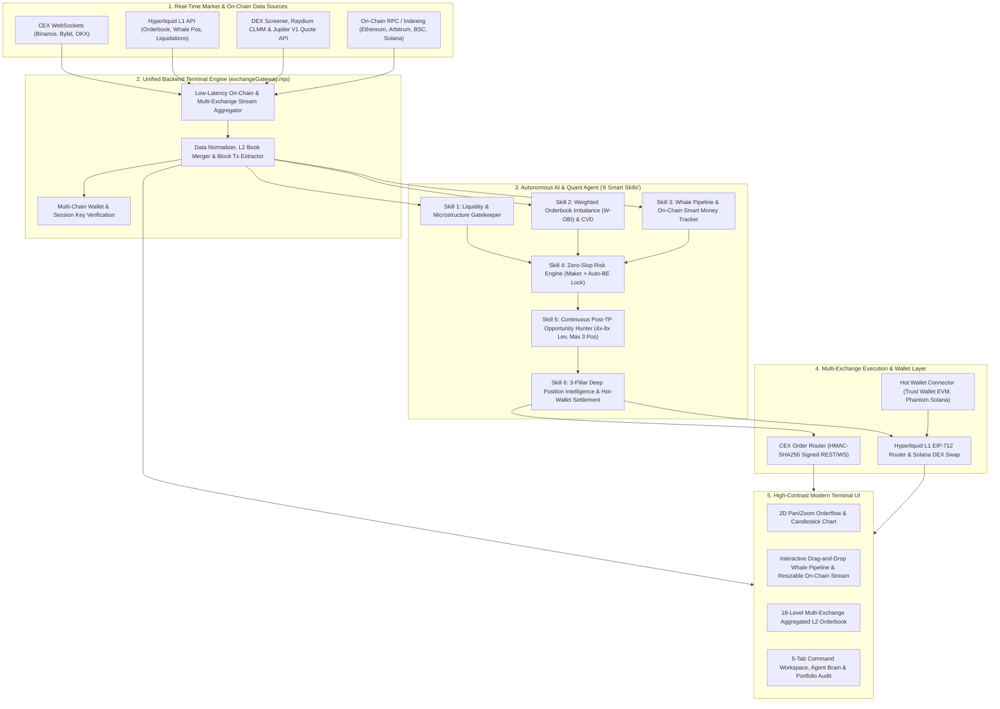

# Master Blueprint: Autonomous Multi-Exchange Crypto Trading Terminal & Whale Intelligence Agent

Dokumen ini merancang arsitektur ujung-ke-ujung (*end-to-end*) untuk **Terminal Trading Crypto Otonom (Spot & Futures)** yang menggabungkan eksekusi multi-exchange (CEX & DEX), pelacakan transaksi *whale on-chain* secara *real-time*, serta antarmuka bergaya *Fincept/Bloomberg Terminal* dengan visual *high-contrast dark*.

---

## 1. Arsitektur Sistem Tingkat Tinggi (High-Level Architecture)

Seluruh data pasar dari CEX, Perpetual DEX, agregator DEX, dan RPC *on-chain* disatukan ke dalam satu **Unified Backend Terminal Engine** sebelum diolah oleh **Autonomous Trading Agent** dan divisualisasikan ke **Terminal UI**.

---

## 2. Modul Kecerdasan Agent ("6 Smart Skills" Architecture)

Agar bot mampu membaca arah pasar secara presisi, hanya masuk di pasar berlikuiditas padat, dan menghindari kerugian sekecil mungkin, Agent dilengkapi **6 Skill Inti** yang berjalan secara paralel dan otomatis:

### Skill 1: Liquidity & Market Microstructure Gatekeeper
Agent tidak akan mengeksekusi posisi pada *market* yang tipis (*illiquid*) untuk menghindari jebakan *slippage* dan manipulasi *spread*.
- **Liquidity Gatekeeper**: Memfilter 14 aset (*Top 10 CoinMarketCap + DEX*) berdasarkan *Minimum 24h Volume*, kedalaman *Order Book* pada jarak `±0.5%` dari *mid-price*, serta *Total Value Locked (TVL)* untuk pool DEX (via DexScreener & Raydium CLMM).

### Skill 2: Weighted Order Book Imbalance (W-OBI) & CVD Absorption
- **Order Book Imbalance (W-OBI) & Spoofing Detector**: Membaca ketimpangan antrean *Bid* vs *Ask* pada 18-level L2 *order book* secara *real-time* dan membedakan *wall* asli vs *spoofing*.
- **Cumulative Volume Delta (CVD) & Absorption**: Mengukur agresivitas *market buyer* vs *market seller* untuk mendeteksi *absorption* institusional.

### Skill 3: Whale Pipeline & On-Chain Smart Money Tracker
Memetakan aliran dana dari *wallet* raksasa untuk mengetahui ke mana *smart money* bergerak sebelum tercermin penuh di *chart*:
- **Hyperliquid L1 Whale & HLP Vault Tracker**: Memantau posisi *open interest*, harga likuidasi, arah *Long/Short*, dan perubahan margin dari *HLP Vault (`0xdfc2...f303`)* serta *recentTrades* berukur besar secara langsung dari Hyperliquid L1 Mainnet.
- **Multi-Chain EVM & Solana Block Transaction Indexer**: Melacak transaksi bernilai besar langsung dari blok terbaru Ethereum Mainnet, Arbitrum One, BNB Smart Chain (`eth_getBlockByNumber`), serta pool likuiditas Solana (Raydium CLMM & Jupiter).

### Skill 4: Micro-Loss Prevention & Capital Protection ("Zero-Slop Risk Engine")
- **Post-Only / Maker-First Execution**: Mengutamakan masuk posisi menggunakan *Limit Post-Only* di pucuk *bid/ask* agar mendapat rabat *Maker* dan menghindari biaya *Taker* + *spread*.
- **Auto-Breakeven + Fee Offset**: Begitu posisi bergerak positif melewati biaya transaksi (`+0.06%`), *stop loss* otomatis digeser ke titik **Breakeven + Fee**, sehingga posisi tersebut menjadi *risk-free*.
- **Orderflow Invalidation Cut (Scratch Trade)**: Menutup posisi di *breakeven* atau rugi sangat mikro (`-0.01%` s/d `-0.04%`) jika dukungan *orderbook* dan *whale* runtuh.

### Skill 5: Continuous Post-Take-Profit Opportunity Hunter (`4x–8x` Conservative Leverage)
- Ketika posisi ditutup (*Take Profit* manual maupun otomatis), Agent langsung memindai seluruh 14 market untuk mencari peluang terbaik berikutnya hingga **maksimal 3 posisi terbuka secara bersamaan** (*diversifikasi koin*).
- Menggunakan **Leverage Konservatif Adaptif (`4x` hingga `8x`)** berdasarkan skor konfluensi risiko dan kepadatan likuiditas.

### Skill 6: 3-Pillar Deep Position Intelligence & Direct-to-Hot-Wallet Auto-Settlement
- Mengevaluasi setiap posisi aktif secara *real-time* menggunakan **3 Pilar Analitik**:
  1. **Orderbook Defense Score (`0–100`)**: Ketahanan tembok *Bid/Ask* dan rasio W-OBI untuk menahan *floating loss* vs *cut loss*.
  2. **On-Chain Whale Conviction Score (`0–100`)**: Aliran dana *on-chain* dan posisi *HLP Vault* searah atau berlawanan dengan posisi.
  3. **Market Sentiment & Regime Score (`0–100`)**: Tekanan *CVD*, *Funding Rate*, dan struktur harga terhadap *EMA-20*.
- **Keputusan Otomatis 4-Arah**: `HOLD_FLOATING_LOSS` (tahan *floating loss* selama pertahanan *whale* & *orderbook* masih kuat), `RIDE_PROFIT_TRAIL`, `AUTO_TAKE_PROFIT_NOW`, atau `AUTO_CUT_INVALIDATED`.
- **Direct-to-Hot-Wallet Profit Settlement**: Setiap profit yang terealisasi otomatis langsung masuk/disinkronkan ke *Hot Wallet* pengguna (**Trust Wallet** / **Phantom Wallet**) tanpa perlu proses *withdraw* manual dari terminal.
